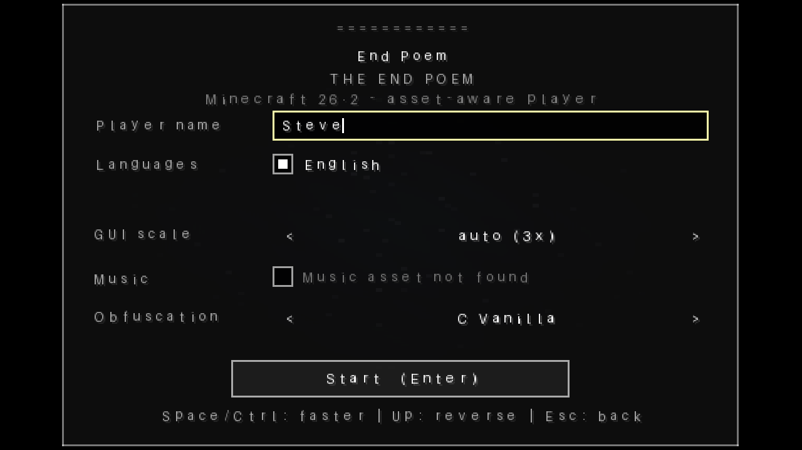

# End Poem Player (Minecraft 26.2, asset-aware)

A fan-made, standalone Java player for the Minecraft "End Poem". The code is
based on the behavior of the 26.2 client, but **this repository does not ship
Minecraft's copyrighted resources**.

This repository intentionally contains only:

- the English End Poem text (public domain);
- generated placeholder textures, shaders and an ASCII font;
- the player source code.

Mojangles, Unifont, Minecraft's shaders/textures, the credits music, the
NetEase Chinese translation and the four Classical Chinese translations are
**not** included. Put a full asset tree that you have the right to use into
`assets/`; the program prefers every user file over the matching placeholder.
Nothing is downloaded automatically.



## Run

Java 17+ and OpenGL 3.3 are required. Linux x86_64 LWJGL natives are included.

```bash
./run.sh
./run.sh --assets=/path/to/your/assets
END_POEM_ASSETS=/path/to/your/assets ./run.sh
```

The default is the English poem with the generated placeholder look. The
music checkbox shows "Music asset not found" until `sounds/alpha.ogg` exists.

Chinese and the four Classical Chinese translations are shown in the language
picker only when their text files exist. If a full font (Mojangles/Unifont) is
also present, all six languages render with the original font metrics.

## Using your own full assets

`assets/` bundled here contains only `end_poem_en.txt`. The program first looks
for each file in `assets/` (or the directory given by `--assets`), then falls
back to `assets-placeholder/`. You can therefore drop in a complete asset tree
without deleting the placeholder fallback.

Expected user files (all optional individually):

```text
assets/
  end_poem_en.txt                 # bundled, public domain
  end_poem_zh.txt                 # optional, your own licensed copy
  end_poem_lzh_shang.txt          # optional
  end_poem_lzh_wang.txt           # optional
  end_poem_lzh_fang.txt           # optional
  end_poem_lzh_ice.txt            # optional
  font/default.json
  font/include/*.json
  font/*.png
  font/unifont.zip
  shaders/core/*.vsh, *.fsh
  shaders/include/*.glsl
  textures/*.png
  sounds/alpha.ogg
```

Only use resources you are allowed to use. Do not commit Mojang, NetEase or
third-party translation assets to this repository.

The exact file layout and metric behavior are documented in `assets/README.md`.

## Regenerating the four Classical Chinese translations

`tools/fetch_wiki_translations.py` downloads the four translation pages with
`curl`, extracts only the translation half of each English/translation pair,
aligns the 76 text lines to the 151-line English file, converts the
player-name placeholder only, keeps the wiki's scrambled-text markers (such as
`[不可讀]`) as literal text, and writes directly into an assets directory:

```bash
python3 tools/fetch_wiki_translations.py --out assets
# or:
python3 tools/fetch_wiki_translations.py \
  --english /path/to/assets/end_poem_en.txt --out /path/to/assets
```

The four output files are byte-identical to the versions used by the full
player. They are derived from 礦藝大典 and remain **CC BY-NC-SA 3.0**; do not
commit them to this repository unless you are complying with that license.
The script itself is GPL-3.0-only.

## Full asset set from the two tools

For a complete local asset tree, run both tools:

```bash
# English, fonts, shaders, textures, Unifont, credits music
python3 tools/extract_minecraft_assets.py /path/to/26.2.jar --out assets

# Optional: the NetEase Chinese text, if you have a NetEase client jar
python3 tools/extract_minecraft_assets.py /path/to/26.2.jar --out assets \
  --zh-jar /path/to/NetEase.jar

# Four Classical Chinese translations
python3 tools/fetch_wiki_translations.py --out assets
```

The only file not supplied by `26.2.jar` alone is `end_poem_zh.txt`; it comes
from the optional NetEase jar. Unifont and the credits music normally live in
Minecraft's external asset-object store; the extractor resolves them through
`--minecraft-dir`/`--index`. If no NetEase jar is available, English and the
four wiki translations still work; the Chinese checkbox simply stays hidden.
Do not publish a tree containing Mojang/NetEase assets.

## Build

```bash
./build.sh
./package.sh
```

`package.sh` creates `dist/` and `EndPoem-26.2-dist.zip`, including both
`assets/` (public-domain English) and `assets-placeholder/`.

## Font in the screenshot

The blocks in this repository's placeholder screenshot are **not Mojangles**.
They are a generated 12px bitmap atlas made from Pillow's bundled **Aileron**
font (CC0), limited to printable ASCII. It exists only so the program is
runnable with zero Minecraft assets. A full `assets/font/default.json` replaces
it automatically and restores the original Mojangles/Unifont look.

## Licenses

- **Code**: GNU General Public License v3.0 only (GPL-3.0-only) — see `LICENSE`.
- **Documentation and screenshots**: CC BY-NC-SA 4.0 — see `LICENSE.CC-BY-NC-SA-4.0`.
- **English End Poem text** (`assets/end_poem_en.txt`): public domain.
- **Generated placeholder assets** (`assets-placeholder/`): GPL-3.0-only, created
  for this project. The placeholder bitmaps were generated with Pillow using
  the CC0 Aileron font; no font software is redistributed.
- **Third-party libraries**: see `THIRD-PARTY.md` and `NOTICE.md`.

Minecraft is a trademark of Mojang Studios / Microsoft. This project is not
affiliated with Mojang, Microsoft or NetEase.

| Content | License |
|---|---|
| Source code (`src/`, `tools/`, build scripts) | GPL-3.0-only |
| README, NOTICE, documentation, screenshots | CC BY-NC-SA 4.0 |
| English End Poem text | public domain |
| Generated placeholder assets | GPL-3.0-only |
